# Генерация исследуемых сцен

Дата: 2026-10-11. Редакция 2: исправления по архитектурному review.
Статус: обновлённая спецификация для review, реализация не начата.

## 1. Цель и согласованные решения

Из контекста места и кампании создавать связную исследуемую сцену для существующей
2D-карты Taleforge. Объекты должны сохраняться после посещений, исследований и переносов.
Новые виды локаций и наборы обстановки добавляются данными; новая игровая механика — кодом.

С пользователем согласовано:

- Филлерные сцены без зацепок к основному сюжету допустимы.
- При первом входе материализуется видимое окружение. Содержимое контейнера — при первом исследовании.
- Модель может придумывать новые объекты обстановки, описания и композицию.
  Возможности взаимодействия выбираются из серверного списка. Переносимые предметы
  с механикой используют проверенные шаблоны каталога.
- Система гибридная: модель предлагает, сервер проверяет и фиксирует факты мира.
- `Entity` — единственная идентичность интерактивного объекта; эскиз ссылается на неё.
Этот документ развивает [этап 0](../../world-objects-stage0.md) и
[план проверок](../../world-objects-stage0-verification.md). Уточнения ниже имеют приоритет
для новых этапов. Документы этапа 0 описывают историческое состояние, а не текущий runtime.

Предлагаемые дополнительные границы первой поставки: генератор не создаёт боевые встречи,
замки, ловушки и новые правила разрушения; не добавляет произвольные переносимые вещи
без шаблона. Эти функции можно внедрять отдельно через реестр возможностей.

## 2. Текущее состояние и разрыв

Проверено в коде на момент подготовки:

| Область | Уже есть | Требуется |
| --- | --- | --- |
| Хранение | `Entity`, `InventoryItem.world_entity_id`, `WorldGenerationState`, `PlotAnchorBinding` | Runtime-переходы подготовки и сюжетных резервов |
| Объекты | `read_world_object`, постоянные уникальные вещи, контейнеры и проверки вложенности | Создание обстановки из проверенного предложения |
| Контейнеры | `create_container`, `open_container`, `inspect_container`, `store_object`, `retrieve_object` в `items.py` | Отдельная команда исследования для отложенного содержимого |
| Карта | `around`, `scene_view`, `sketch`, исключение вложенных объектов | Ссылки элементов эскиза на сущности и единая фильтрация |
| Эскиз | `surveyor`, `layout_rev`, защита ручного рисунка | Ревизия размещения и учёт связанных объектов |
| События | Savepoint инструментов, запись inverse, уведомления после фиксации | Атомарные события материализации; исполнитель пользовательской отмены — отдельная задача |
| Ход мастера | Повествование до общего коммита в `app/agents/master/turn.py` | Сохраняемая граница между применением действия и описанием результата |

`WorldGenerationState` и `PlotAnchorBinding` сейчас объявлены в ORM, но не управляют
генерацией. `create_container` создаёт пустой контейнер с `contents.status = ready`.
`inspect_container` — read-only и ничего не генерирует. Эти контракты сохраняются.
Наличие `Event.inverse` не означает наличие готового undo-dispatch: исполнитель отмены
и анализ зависимостей событий в проверенном коде не обнаружены.

## 3. Архитектура и зависимости

```mermaid
flowchart LR
    A[Команда входа или исследования] --> O[Оркестратор подготовки]
    O --> C[Снимок контекста]
    C --> P[Профиль и план допустимого наполнения]
    P --> G[Предложение: шаблоны или модель]
    G --> V[Валидация]
    V --> M[Атомарная материализация]
    M --> E[Entity и события]
    E --> R[Проекция для зрителя]
    R --> U[Карта и инспектор]
```

Предлагаемый пакет `app/core/world_generation/` содержит:

- `contracts.py`: типизированные входы, предложения, планы и результаты; без ORM и LLM.
- `profiles.py`: загрузка и проверка профилей через существующий каталог контента.
- `context.py`: снимок фактов, ревизий и разрешённых сюжетных обязательств.
- `policy.py`: детерминированный план обстановки, добычи и резервов.
- `validation.py`: проверка предложения и согласованности с планом.
- `service.py`: оркестрация lease, повторов и результата.
- `storage.py`: короткие транзакции, CAS и материализация в существующие таблицы.

Общие правила записи мира, пространственного доступа и видимости располагаются вне этого
пакета и используются обычными инструментами тоже. Генератор не получает собственную,
отличающуюся от игрового движка проверку доступа или геометрии.

LLM-адаптер находится в `app/agents/world_generator.py` и использует текущий клиент моделей.
Он зависит от контрактов, но не записывает `Entity`. Оркестратор получает адаптер как
зависимость; детерминированный provider реализует тот же контракт без LLM.
Не вводятся отдельный сервис, брокер задач или новый реестр объектов.

Серверный реестр возможностей описывает допустимые роли, требуемые данные и существующий
обработчик действия. Он не разрешает динамический код из профиля или ответа модели.
Клиент получает доступные действия из проекции, а не выводит их из текста описания.
## 4. Контракты данных

### 4.1. Профиль локации

Новый тип контента `scene_profile` с версией схемы 1; его поддержка добавляется в проверку
пакетов и `CatalogView`. Поля:

- `schema_version`, `id`, версия источника;
- `theme_tags`, разрешённые роли и наборы возможностей;
- лимиты объектов, контейнеров и вложенности;
- разрешённые шаблоны предметов или поддерживаемые таблицы добычи;
- бюджет добычи и наборы серверных конструкций обстановки для fallback;
- правила размещения: размеры объектов, свободные проходы и допустимые зоны.

Ссылка на профиль находится в данных шаблона локации или явно назначается ведущим.
Явное назначение имеет приоритет над шаблоном. При отсутствии профиля используется
версионированный `minimal`: без случайной добычи и контейнеров, сохраняющий существующие
объекты; обязательства сюжета всё равно должны быть выполнены или явно заблокированы.

Профиль не содержит обязательных сюжетных зацепок. Неподдерживаемые варианты `loot_table`
отклоняются при подключении таблицы к профилю генерации; ранее допустимый пакет с таблицами
для других подсистем продолжает загружаться. `proposal` доступен только
по текущим правилам кампании. Автоматического выбора профиля по свободному тексту нет.

### 4.2. Снимок входа

`GenerationContext` включает кампанию, цель и фазу; имя, историю и состояние места;
профиль и версии использованных источников; разрешённые сюжетные обязательства;
существующие сущности и их размещение; геометрию и её ревизии; лимиты и seed.
В LLM передаётся минимальная необходимая часть, а не весь тайный каркас кампании.

Существующие факты, авторские объекты, посещения и ручные правки — ограничения.
Модель может добавить несюжетную деталь, но не устанавливать новые факты о болезни,
злодее или судьбе алхимика. Содержимое будущего контейнера не описывается как уже увиденное.

### 4.3. План и предложение

`GenerationPlan` выдаёт стабильные локальные слоты, их роли и ограничения, выбранные
сервером шаблоны и количества наград, обязательные носители и допустимые позиции.
Для нового `prop` шаблон необязателен. Для механического `item` обязателен.
Выбор механических предметов выполняется детерминированной policy до обращения к LLM;
модель не выбирает между разными наградами из allowlist. Свобода модели относится
к описанию, допустимой обстановке и композиции. Идентификаторы слотов назначает policy,
а не модель: изменение порядка объектов или их имён не меняет seed потомков.

`SceneProposal` имеет `schema_version` и ограниченный список объектов:

- `local_ref` — уникальная ссылка внутри предложения;
- разрешённый `slot_ref`, `role`, `name`, немеханическое `description`;
- `template_id`, если требуется планом;
- разрешённые `capabilities`;
- предлагаемый слот размещения и ссылка на родительский контейнер;
- ссылка на назначенный сюжетный носитель, только если он выдан в плане.

Не принимаются реальные id создаваемых сущностей, произвольный `state`, числа эффектов,
стоимость, количество наград, новая геометрия комнаты и новые сюжетные обязательства.
Схемы запрещают неизвестные поля и имеют явные лимиты строк и количества объектов.
Сервер назначает id, физическое состояние, количество и окончательное размещение.

### 4.4. Постоянное состояние

Сохраняются `world_object` схемы 1, роли `prop/container/item`, текущие `physical`,
`access` и `revision`. `visual_key` остаётся в `Entity.state` и не влияет на механику.
Не поддерживаемую роль, возможность или версию нельзя молча принять.

`WorldGenerationState` — источник истины о фазе подготовки. Для генерируемого контейнера
создаётся отдельная строка `container_contents` со статусом `unprepared` и резервом.
`world_object.contents.status` — совместимая сводка, обновляемая вместе с этой строкой;
сервис не принимает решение о генерации по одной сводке. Уже существующее значение
`ready` означает готовое содержимое, даже если оно пустое и строки подготовки нет.

`reservation` хранит неизменяемый механический план: `schema_version`, `policy_version`,
версию PRNG, seed, упорядоченные слоты, ограничения, выделенные бюджеты и сюжетные резервы.
В нём закрепляется цепочка версий пакетов кампании и нормализованные входы отбора добычи.
Ссылки разрешаются через эту цепочку, не через latest. Для вычисления поздних результатов
поддерживается именно сохранённая версия policy/PRNG; её отсутствие даёт `blocked`.
Смена модели не влияет на механические результаты, в том числе ещё не открытых контейнеров.

Каталог уже версионируется. Копия входов отбора не становится вторым движком применения
предметов: экипировка и использование продолжают читать закреплённый каталог кампании.
Если нужная версия шаблона недоступна, материализация блокируется до восстановления
источника; другой шаблон или выдуманная механика не подставляются. Автоматического
обновления цепочки контента при исследовании нет.

Для runtime добавляются явные поля `requested_at`, `next_attempt_at`, `llm_attempt_count`,
`conflict_count` и `result_manifest` в `WorldGenerationState`. `attempt_count` считает
захваты lease, а `llm_attempt_count` — зарезервированные вызовы модели за всю жизнь фазы.
Manifest — закрытый структурированный результат с назначенными id; после `ready` неизменяем.
Ожидание выполнения и счётчики не записываются внутрь неизменяемого `reservation`.

### 4.5. Бюджеты и вложенность

`loot_budget` — неотрицательное целое число условных единиц наполнения, не цена продажи.
Каждый разрешённый механический шаблон имеет положительную целочисленную `generation_cost`
в профиле. Одна единица количества расходует указанную стоимость; стоимость не задаётся LLM.
Ограничения редкости, типа и количества действуют дополнительно к бюджету.

Бюджет относится ко всей локации, включая отложенные и вложенные контейнеры. Корневой
план распределяет его между добычей на виду и резервами контейнеров. Для любого узла:

`стоимость прямых находок + сумма резервов дочерних контейнеров <= резерв узла`.

Дочерний контейнер получает долю родительского резерва, не новый полный бюджет.
Пустое содержимое и неиспользованный остаток не перераспределяются после исследования.
Seed потомка выводится из корневого seed и пути стабильных слотов; дата открытия,
уровень героев и порядок исследований в derivation не участвуют.

Отдельно ограничены суммарные `max_generated_entities`, `max_item_units`, `max_containers`
и глубина. Лимиты распределяются по дереву вместе с бюджетом; обычный стак занимает одну
Entity, но расходует `qty` единиц количества и `qty * generation_cost` бюджета.
Обстановка без механических наград не расходует loot_budget, но занимает лимит сущностей.
Если корневой план не может выделить слот и лимиты потомку, он не создаёт этот контейнер.

Авторская/назначенная ведущим добыча и обязательные сюжетные награды сохраняются и
учитываются до случайных находок. Вход содержит их стоимость по тому же профилю либо
явную оценку ведущего; неизвестная стоимость обнуляет случайный остаток с диагностикой,
но не блокирует декор или сохранение авторской добычи.
Чистая сюжетная записка без механической ценности может иметь явную оценку 0. Превышение
бюджета обязательными наградами сохраняет их, обнуляет случайный остаток и записывает
диагностику для ведущего. Предметы, принесённые героями, не считаются наградой локации.
Состав учтённых наград фиксируется в резерве; их последующий вынос не освобождает бюджет.

Пример: при бюджете 100 авторская добыча на 20 оставляет 80. На виду выделено 10,
шкафу 40 и ящику 30. Вложенная шкатулка может получить 15 из 40 шкафа; на остальные
находки шкафа остаётся не более 25. Дополнительных 100 у шкатулки нет.

## 5. Карта, идентичность и координаты

В `sketch.features` добавляются необязательные `feature_id` и `entity_id`.
Новые связанные элементы имеют стабильный `feature_id`; ссылка разрешена только на
объект той же кампании и комнаты, размещённый в мире, не внутри контейнера.
На одну сущность приходится не более одного связанного элемента в комнате.
Старые элементы без ссылок продолжают работать; совпадение имён не создаёт связь.

Для связанного объекта геометрия `feature.cells` задаёт абсолютный footprint.
Северо-западная занятая клетка — якорь только для подписи/рисования. `Entity` определяет имя, доступность,
физическое состояние и возможности; имя элемента не становится вторым источником.
Геометрические свойства укрытия остаются проверенными серверными данными.

Текущий `Entity.state.cell` использует координаты относительно `sketch.party`.
Адаптер позиции вычисляет относительный якорь связанного объекта из абсолютной геометрии;
дублировать его вручную в `state.cell` не требуется. Пространственный адаптер также
предоставляет footprint и позиции подхода; игровая дистанция не вычисляется по якорю
рисования. Несвязанные точечные объекты сохраняют прежний контракт.

`interaction_cells` — свободные клетки подхода вне footprint, соприкасающиеся с разрешённой
стороной объекта. По умолчанию доступны соседние клетки по правилам перемещения движка;
для шкафа профиль может ограничить подход стороной дверцы. Диагональ через угол стен
не считается подходом. Для касания/открытия/исследования герой должен находиться в одной
из этих клеток. Для иных дистанционных действий расстояние измеряется до ближайшей
разрешённой клетки объекта с проверкой линии видимости, а не до северо-западного угла.
В связанном feature хранится проверенный `access_sides` (подмножество `n/e/s/w`,
по умолчанию все стороны). `interaction_cells` вычисляются из него и footprint;
они не сохраняются вторым набором координат, способным устареть.

Валидатор размещения проверяет достижимость хотя бы одной клетки взаимодействия каждого
нового объекта и сохранение путей к ранее доступным выходам. Используется существующая
топология и правила обхода стен; временные позиции героев и существ при этой проверке
не считаются постоянными препятствиями. Недоступный декоративный элемент без действий
допустим. При переносе footprint клетки подхода пересчитываются и проверяются заново.
Без сетки доступ использует существующие правила зоны/комнаты, без выдуманной точной дистанции.

Связанный объект представлен одной фигурой на сетке: footprint с id и точкой взаимодействия.
`around` сохраняет запись для списка и инспектора, но клиент не рисует поверх footprint
второй токен из `scene_view`. Фильтрация общая для обоих представлений.

Подбор, вложение или уничтожение убирает связь и footprint в той же транзакции.
Возврат предмета на пол использует обычное позиционирование и не восстанавливает мебель
по старому имени. Ручное удаление footprint снимает связь и сохраняет сущность как
несвязанный объект; удаление самой вещи требует отдельного игрового действия.
Перемещение linked-feature меняет геометрию, а не клонирует объект.

Добавляется монотонная `placement_rev` локации для изменений footprint и размещения;
она независима от существующей `layout_rev`. Мутации, затрагивающие связанное размещение,
повышают её. `surveyor` не перезаписывает связанные и ручные элементы устаревшим ответом.
Повторная генерация геометрии не создаёт сущностей из подписей мебели.

Без пригодного эскиза используется существующая схема зон: объекты можно материализовать
без точной клетки. Когда появится геометрия, отдельная операция размещения может связать
уже существующие объекты, сохраняя их id и число. Fallback не создаёт новый план комнаты.

## 6. Подготовка и конкурентность

### 6.1. Фаза подготовки и подтверждение команды

Фазы: `location_initial` и `container_contents`; ключ уникальности — текущая тройка
`campaign_id/target_entity_id/phase`. `WorldGenerationState.id` используется как
`operation_ref`; это идентичность подготовки, не команды игрока. Статусы не расширяются:

| Состояние | Поведение |
| --- | --- |
| `unprepared` | До `requested_at` это только резерв; после запроса можно получить lease |
| `preparing` | Работает один владелец lease; остальные получают `pending` |
| `ready` | Возврат сохранённого результата, без генерации |
| `blocked` | Диагностируемая проблема; явный retry после исправления |

Команда имеет независимый `command_key` и подтверждение в `Event`. Принятие исследования
сохраняет `{accepted: true, operation_ref}`. Это неизменяемая квитанция, без сохранённого
`pending` в качестве итогового результата. Существующий `execute` может воспроизводить
квитанцию по своему ключу идемпотентности; повтор не исполняет действие второй раз.

Read-only операция `generation_status(operation_ref)` возвращает текущее `pending/ready/blocked`
с ревизией результата, а после `ready` — разрешённую зрителю проекцию. Она доступна через
серверный интерфейс и инструмент чтения мастера. Неактивированный резерв контейнера
отображается как `unexamined`, а не как уже выполняющийся `pending`. Чтение не ставит задачи.
Авторизация проверяет кампанию и право видеть цель; знание operation_ref не даёт доступа.

Подтверждение команды и статус возвращаются отдельными полями: транспортный повтор
может обогатить старую квитанцию свежим статусом, не изменяя `Event.payload`.
Клиент после переподключения перечитывает статус; завершение не зависит от доставки
единственного WebSocket-уведомления. `map.changed` остаётся сигналом перечитать проекцию.

### 6.2. Короткие транзакции изменения мира

Добавляется числовой столбец `Campaign.world_revision` с default 0. Общий адаптер
`world_write(campaign_id, expected_revision)` начинает короткую транзакцию условным
UPDATE этой строки (`world_revision = world_revision + 1 WHERE world_revision = expected`).
Ноль изменённых строк означает конфликт и полный rollback; прочитать новый мир и повторить
команду можно только после повторной проверки её предусловий. Это также сериализует
защищённые записи одной кампании на время транзакции. Сетевые вызовы внутри неё запрещены.

Все данные для изменения перечитываются после успешного UPDATE. Нельзя записывать старые
ORM-объекты, загруженные до него. Предложение генератора хранит ожидаемую world_revision;
успешный UPDATE и последующая запись результата находятся в одной транзакции.
Поэтому обычный writer не может вклиниться между проверкой и записью результата.
Digest нужен для диагностики и сравнения снимков, но не используется вместо этого протокола.
Guard захватывается один раз на транзакцию; вызываемые из неё helpers используют тот же
контекст, а не открывают вложенный world_write с независимым коммитом.

Участники протокола обязательны, включая пути без вызова реестра инструментов:

| Мутации | Проверяемые данные |
| --- | --- |
| Вход/выход героя, перенос, выдача и удаление вещей | Комната, владельцы, количество, состояние персонажа |
| Открытие/закрытие, вложение и извлечение | Состояние цели и вся цепочка контейнеров |
| `sketch_place`, `edit_sketch`, `reposition`, результат `surveyor` | Геометрия, ссылки, позиции и ручные правки |
| Авторские изменения, сюжетные резервы, пересмотр сюжета | Существующие сущности и обязательные носители |
| Раскрытие знаний, права участника, смена разрешений контента | Видимость, разрешённые действия и источники |

Приёмка интеграционного этапа включает инвентаризацию этих writers и перевод их на общий
адаптер. Одного изменения генератора недостаточно. Для первой версии выбрана ревизия
кампании: она даёт лишние конфликты между разными комнатами, зато не требует согласовывать
несколько блокировок. Деление ревизий по комнатам возможно позже по результатам измерений.
`placement_rev` остаётся локальной версией геометрии, а не заменой world_revision.

На PostgreSQL условный UPDATE блокирует конкурентное изменение строки. На SQLite
используется свежая короткая write-транзакция; `SQLITE_BUSY`/конфликт снимка приводит
к rollback и ограниченному повтору, не к частичному успеху. Процессный `turn_lock`
упорядочивает ходы, но не заменяет защиту записей в БД.

### 6.3. Выполнение одной подготовки

В поддерживаемом сейчас однопроцессном сервере оркестратор выполняет фазы одной кампании
последовательно под отдельным `Coordination.generation_lock`, не под `turn_lock`.
Это предотвращает взаимные конфликты двух подготовок на общей world_revision.
Блокировки БД остаются обязательными для защиты от обычных writers и перехвата lease.
Поддержка нескольких серверных процессов не объявляется частью этой поставки.

Claim/смена lease выполняются условным UPDATE строки `WorldGenerationState` с проверкой
статуса, её revision и срока владения; конфликт уникальной вставки перечитывает готовую
строку. Все операции, которым нужны обе защиты, сначала захватывают world_write,
затем изменяют строку фазы. Продление lease меняет только строку фазы и не берёт второй lock.
Истёкший lease допускает новый токен; seed и резерв сохраняются. Время берётся из БД.

Протокол:

1. В короткой транзакции world_write проверить цель, получить lease и сохранить снимок
   контекста с итоговой world_revision. Если другой исполнитель уже готовит фазу,
   вернуть её operation_ref без второй работы.
2. Закрыть транзакцию. Сформировать и проверить предложение вне неё; LLM-вызов ограничен
   timeout. Начальный лимит — один вызов и одна корректирующая попытка, затем fallback.
3. Через world_write с ожидаемой ревизией перечитать целевые данные. Условный UPDATE фазы
   проверяет `preparing`, токен, последнюю revision собственного владения и неистёкший lease;
   проверить число изменённых строк. Собственные обновления счётчиков также выполняются
   через CAS с токеном, а возвращённая revision сохраняется исполнителем.
   Неуспех любого условия откатывает всю транзакцию. Повторно проверить физическое состояние,
   авторские правки и резервы. Изменение контейнера/родителя делает прежний снимок устаревшим.
4. Записать весь набор сущностей, связи эскиза, резервы контейнеров, сюжетные привязки,
   `ready`, `result_digest` и `Event` атомарно. Сохранить закрытый manifest результата.
5. После коммита отправить `map.changed`; проекция загружает сохранённый мир.

После принятия исследования материализация — внутренняя подготовка мира: она не выдаёт
предметы герою; наблюдение результата подчинено общей policy раздела 8. Уход героя или закрытие
контейнера требует нового снимка, но само по себе не отменяет уже оплаченный запрос.
Результат остаётся внутри контейнера; его чтение и извлечение заново проверяют доступ.
Уничтоженная/удалённая цель не восстанавливается: фаза блокируется, если строка цели ещё есть.

### 6.4. Граница игрового хода и восстановление

Текущий `_play` создаёт повествование до коммита. Для подготовки это меняется явно,
а не добавлением фонового signal к прежнему порядку. В `MasterTurn` вводится
версионированный JSON `generation_checkpoint`: этап, id принятых событий, operation_refs,
данные результата игровых действий, сведения об аудитории и id сообщения повествования.
Checkpoint не содержит живых объектов ORM. Существующий `status` сохраняет значения
`running/done/failed`; этапы checkpoint — `effects_committed`, `preparing`, `narration_pending`, `done`.

1. Планирование моделью выполняется вне write-транзакции. В короткой транзакции применяются
   проверенные действия; вход/исследование записывают запрос подготовки, событие и checkpoint
   атомарно. После команды, требующей подготовки, дальнейшие инструменты этой серии
   не выполняются. Механические последствия уже принятого действия фиксируются один раз;
   клиент получает квитанцию, но не описание ещё не существующих находок.
2. Транзакция закрывается. Оркестратор ожидает терминального результата всех запрошенных
   фаз. До готовности видны сохранённая геометрия и авторские объекты. Создание комнаты-
   навигатора не активирует `requested_at`. Задача материализации не захватывает `turn_lock`,
   который ожидающий ход уже может удерживать; она использует короткий world_write.
3. После `ready` либо `blocked` мир перечитывается. Из свежей разрешённой проекции и
   сохранённых результатов создаётся повествование. При `blocked` описываются только
   подтверждённые факты, а недоступность исследования сообщается отдельно.
4. Текст и `done` сохраняются вместе. Повествование не выполняет игровые действия.
   Перед публикацией повторно проверяются актуальные права аудитории.

Сбой до effects_committed откатывает действия. Сбой после него сохраняет действия и
возобновляет только подготовку/повествование; повторный запуск decision-инструментов запрещён.
Нынешнее сообщение «Ничего не изменилось: повторите действие» для такого сбоя заменяется
на подтверждение сохранённого действия и незавершённого описания. Завершённая механика
боя, расходы и outbox имеют id в checkpoint и не воспроизводятся повторно.

Ряд сообщения повествования резервируется один раз на checkpoint. Повтор генерации текста
обновляет ту же запись и заменяет прежний незавершённый черновик; после `done` новое
повествование для этого checkpoint не создаётся. Уведомление можно доставить повторно
с тем же id. Это не обещание exactly-once доставки по сети.
Счётчик попыток описания сохраняется в checkpoint: после двух неуспехов ход получает
`failed`, игрок видит сохранённый результат действия и ошибку описания. Автовосстановитель
больше не вызывает модель для такого хода. Явный retry описания возобновляет только этот
этап, с прежним id сообщения. Все вызовы учитывают текущий лимит расходов кампании.
Для прямой команды UI без `MasterTurn` достаточно квитанции и operation_ref; искусственный
ход мастера ради подготовки не создаётся.

При запуске сервера восстановитель сначала читает незавершённые checkpoint и активированные
фазы. Далее он проверяет их каждые 15 секунд и по локальному сигналу после коммита.
Только `requested_at != null` разрешает фоновую работу: закрытые неизученные контейнеры
не генерируются при запуске сервера. БД является очередью восстановления; сигнал в памяти
лишь ускоряет её обработку. GET карты и статуса не запускают генерацию.

Начальные настройки: timeout LLM 20 секунд, lease 90 секунд, максимум два LLM-вызова
за жизнь фазы. Слот вызова резервируется в БД до сетевого обращения; авария не обнуляет
счётчик. После исчерпания используется deterministic fallback. Два конфликта исходного
мира за попытки подготовки переводят фазу в `blocked/stale_context`; бесконечного pending нет.
Retry — отдельная mutating-команда ведущего с новым command_key, сохраняющая резерв,
seed и лимит LLM. Она сбрасывает счётчик конфликтов и планирует попытку, но не расход героя.
Ошибки инфраструктуры могут задержать восстановление до возвращения БД/сервера;
истечение lease само по себе не является игровым событием или новым броском.
После первого конфликта исполнитель освобождает lease условно по своему токену,
переводит фазу в активированный `unprepared` и ставит `next_attempt_at = now + 1 секунда`.
Worker берёт только активированные `unprepared` с наступившим сроком и `preparing`
с истёкшим lease. `blocked` и `ready` автоматически не планируются. Для недоступной модели
или исчерпанного бюджета кампании сразу используется fallback без сетевого вызова.

## 7. Исследование контейнера

Новая mutating-команда `search_container(character_id, container_id)` инициирует подготовку.
Её вход проходит общую проверку кампании, текущей видимости, дистанции/подхода и открытых
родителей (разделы 5 и 8). Текущая `_accessible_container` переносится на эту же policy;
одной проверки присутствия в комнате при наличии сетки недостаточно.
Сам контейнер должен быть открыт и доступен. Открытие меняет только доступ;
исследование принимает запрос по протоколу раздела 6 и затем позволяет прочитать результат.
UI явно предлагает открыть закрытый контейнер и затем исследовать его.

`inspect_container` остаётся read-only. Неготовый контейнер возвращает состояние
«не исследован», не утверждение «пуст». `search_container` без строки подготовки у
ручного готового контейнера просто читает текущие предметы.

В момент принятия первого исследования неразрешённой фазы в бою вызывается
`economy.charge(..., "search")`; вне боя отдельная стоимость пока не вводится.
Расход, событие-квитанция и `requested_at` записываются одной транзакцией. Отказ в доступе
до принятия не расходует действие. Транспортный повтор с тем же ключом возвращает квитанцию.
Повтор того же героя для той же pending-фазы, даже с новым ключом, также присоединяется
к исходному запросу без нового расхода; первоначальный запрос находится по событию,
actor_id и operation_ref. Другой герой может прочитать статус доступной цели без расхода
и не оплачивает уже принятую подготовку повторно. Готовое содержимое читается без расхода.
У инструмента `search_container` устанавливается `closes=False`; отметку `ctx.closed`
добавляет обработчик только при первом принятии действия. Иначе общий реестр закрыл бы
действие даже при простом повторе/чтении готового результата.

Выполнение worker и retry ведущего никогда не вызывают economy. При `blocked` уже принятое
исследование сохраняет свой расход: автоматический возврат мог бы затронуть другой ход боя.
После технического исправления возобновляется тот же запрос, без повторной оплаты.
Интерфейс различает принятый запрос, ожидание и неуспех подготовки. Эти правила касаются
первичного наполнения; повторные поиски тайников/проверки навыка — отдельная механика.

Внести вещь в неразрешённый генерируемый контейнер можно только после успешного
исследования. Это исключает зависимость случайного наполнения от добавленных игроком
предметов. Предметы нельзя извлекать или подбирать до materialization и проверки доступа.

Seed, версия правил, бюджеты и сюжетные резервы фиксируются при создании контейнера,
а не по уровню героев в момент исследования. Готовый пустой контейнер не перегенерируется.
Вложенный генерируемый контейнер получает свой резерв вместе с материализацией родителя,
с seed, производным от зафиксированного плана родителя, и с теми же лимитами глубины.

Разрушение неразрешённого контейнера пока не предлагается как capability. Будущее
действие сначала разрешает содержимое, затем применяет правила разрушения. Отключение
генератора не стирает ранее зарезервированный мир: такие контейнеры разрешаются
детерминированным provider без LLM.

## 8. Сюжет, видимость и совместимость

### 8.1. Сюжетные обязательства

Сюжетная система назначает обязательства независимо от наполнения. Пустой список допустим.
`PlotAnchorBinding` резервируется до случайных наград и проверяется в финальной транзакции.
Для новых привязываемых зацепок сюжетный контракт получает стабильный `anchor_id`;
индекс массива или хеш изменяемого текста не используется как идентичность.
Старые зацепки не получают привязку по догадке: нужен явный адаптер/миграция в сюжетном этапе.

Если обязательный носитель уже существует, используется его id без копирования.
Если он утрачен, binding получает `lost`; случайный генератор не восстанавливает его.
Ревизия сюжета не переписывает материализованный факт; замена — отдельное сюжетное событие.
Требование нескольких источников зацепок относится к сюжетному плану, а не каждой комнате.

### 8.2. Знание, текущая видимость и действие

Единая policy возвращает независимые `known_level`, `visible_now` и разрешённые действия.
`Knowledge.level` — объём уже открытых сведений, не право видеть текущее состояние объекта.
Она используется в `party_map`, инспекторе, списках целей инструментов, содержимом
контейнеров и проверках самих команд. Проверка идёт в следующем порядке:

| Проверка | Правило |
| --- | --- |
| Принадлежность | Другую кампанию не раскрывать независимо от переданного id |
| Память | `Knowledge` и видимые прошлые сообщения разрешают историческую карточку |
| Физическое присутствие | Объект находится в текущей комнате/разрешённом инвентаре и не уничтожен |
| Скрытость | `hidden/secret` требует явного раскрытия физического объекта этому герою |
| Вложенность | Каждый родитель существует, видим и открыт; цикл/неизвестный родитель запрещает доступ |
| Действие | Нужны capability, видимость сейчас, подход/дистанция, физическое состояние и игровые ресурсы |

Индивидуальное раскрытие хранится отдельно от уровня знаний: nullable `Knowledge.revealed_at`
(новое поле миграции) означает явное обнаружение физического объекта. Обычные упоминания
и `learn_fact` не заполняют его. Явная команда обнаружения заполняет его и обновляет
ревизию мира: существующий `reveal_knowledge` получает `discovered: bool = false`.
Значение true — явное раскрытие ведущим, с проверкой прав инструмента и сущности.
Для старых знаний default null: наличие слуха не раскрывает скрытый тайник.
Раскрытие не отменяет проверок текущей комнаты, закрытых родителей и дистанции.

Герой, помнящий предмет внутри закрытого шкафа, получает известную карточку, но не его
текущее положение, количество, состояние или действия. Для такой карточки используются
явно сохранённые известные факты и видимые сообщения. Изменяемое `Entity.description`
не подставляется как «воспоминание», если его актуальная версия сейчас недоступна.
Первоначально известное имя/описание сохраняется в новом nullable JSON
`Knowledge.observed_snapshot = {schema_version, name, description, observed_at}` при наблюдении;
старые строки без снимка используют доступную историю либо нейтральную карточку без
догадок. Обновлять снимок можно только при новом разрешённом наблюдении, не из GET.
Внутренний `observe_entities` применяется в транзакциях входа, раскрытия, открытия,
материализации и переноса для присутствующих героев, которым policy разрешает видеть
объекты. Он обновляет снимок только публичными на этот момент полями. Закрытые контейнеры,
отсутствующие герои и скрытые объекты не получают побочного раскрытия.

У неизвестной невидимой сущности не выдаётся даже `entity_id` в feature. У известного,
но невидимого предмета допустима историческая карточка, но нет актуального маркера на карте.
Открытый контейнер не публикует содержимое всей кампании: проекция проверяет конкретного
зрителя. Ведущий может видеть закрытые сведения в своём представлении; действие от имени
героя всё равно проходит проверки героя. Клиентская фильтрация не считается защитой.

Общее `map.changed` содержит только id места. Manifest, резервы, seed, скрытые имена
и детали ошибок доступны серверу/ведущему, не общему событию. Проверки доступа выполняются
повторно при действии, даже если кнопка была ранее доступна.

### 8.3. Совместимость

Существующие кампании и локации автоматически не наполняются. Включение генерации
явное; существующие места фиксируются `ready/legacy_preserved`. Для новых мест после
включения записывается `unprepared`. Ранее созданные навигаторы могут быть подготовлены
только отдельной явной операцией с проверкой авторских данных.
Данные авторского приключения не заменяются атмосферой: encounters не спавнятся,
treasure и secrets проходят авторские ограничения. Статическая иллюстрация книги
не является источником динамического состояния.

## 9. Ошибки, события и диагностика

Невалидный LLM-ответ проходит максимум одну корректирующую попытку. Затем детерминированный
fallback строит сцену из тех же ограничений и резервов; при успехе `quality = fallback`.
Если обязательство невозможно выполнить безопасно, фаза становится `blocked`, а не
`ready` с потерянной зацепкой. Отсутствие декоративных объектов само по себе не ошибка.

Смена входных данных вызывает повтор снимка с прежним seed и резервом; лимиты конфликтов
и LLM-вызовов сохраняются в БД по разделу 6. Перезапуск не обнуляет их. Истёкший lease
можно перехватить только для активированного запроса. Чтение карты/статуса ничего не запускает.

Коды результата: `ready`, `pending`, `blocked`; причины ошибок включают `access_denied`,
`invalid_proposal`, `unsupported_source`, `stale_context`, `lease_lost`, `plot_conflict`.
Готовность различается от качества. Пустая сцена/контейнер — корректный `ready`.

`LlmCall.purpose` отделяет генерацию окружения и содержимого от `sketch`. Диагностика
фиксирует фазу, версии, длительность, попытки, стоимость и причину fallback без утечки
закрытых данных игроку. Digest вычисляется по канонической сериализации и не заменяет CAS.

Событие материализации содержит обратную дельту для объектов, ссылок, binding и состояния
подготовки. Это журнал для диагностики и будущего механизма отмены, не готовая команда undo.
В эту поставку входит транзакционный rollback при ошибке: ни половина предметов, ни
частично изменённые резервы не сохраняются. Пользовательский undo после коммита исключён.
Будущая отмена потребует отдельного проекта зависимостей и правил сохранения уже раскрытой
информации; удалением `Event` или сбросом `ready` она не реализуется.
После коммита исправление мира выполняется явными разрешёнными командами ведущего;
выданная добыча не пересоздаётся, закрытый manifest хранит исходный результат для аудита.

## 10. Проверки и последовательность внедрения

Это несколько последовательных поставок. Не объединять всю систему в один runtime PR.

1. **Связь карты и объектов:** ссылки features, footprint/подходы, достижимость, правила
   снятия связи, защита ручных правок и общая policy видимости/доступа. Включает необходимые
   изменения `Knowledge`, инспектора и существующих контейнерных инструментов. Генерация выключена.
2. **Транзакции и граница хода:** world_write, перевод всех перечисленных writers,
   checkpoint в `MasterTurn`, квитанции и read-only статусы, восстановление повествования.
   Проверка с тестовым provider без предметов и LLM. Это самостоятельный интеграционный
   этап с регрессиями ходов, боя, сообщений и авторских изменений, а не побочная часть генератора.
3. **Детерминированная подготовка:** профили и бюджетное дерево, snapshot, reservation,
   lease/CAS, fallback, `search_container`, восстановитель и транзакционный rollback.
   Сначала без сюжетных обязательств;
   попытка передать их явно отклоняется, не игнорируется.
4. **Сюжетные резервы:** стабильные id, bindings, авторский контент и конфликты ревизий.
5. **Техническая модель:** строгие предложения, бюджет вызовов и защита устаревших ответов.
6. **Интерфейс исследования и включение:** кнопки, состояния подготовки, согласованность
   текстовых команд и UI, явное включение в кампании.

Первый подробный implementation plan должен покрывать только поставку 1, сохраняя эти
границы интеграции. Остальные получают отдельные планы после завершения предыдущих.

Обязательные проверки добавляются вместе с соответствующим поведением:

- Один шкаф: одна Entity, один footprint, один визуальный объект; корректные дистанции
  после смены `party`, переноса, вложения и редактирования.
- Стол 4×2 клетки: герой у дальнего от якоря края взаимодействует с ближайшей частью;
  шкаф со стороной доступа не открывается через заднюю стенку. Выходы остаются достижимыми.
- Скрытая связанная сущность отсутствует во всех полях ответа другого зрителя.
- Известный предмет в закрытом шкафу доступен как память, но его актуальные свойства,
  положение и действия не раскрываются. Упоминание/слух не раскрывает скрытый контейнер.
- Два одновременных входа/исследования; один manifest и один успешный набор объектов.
- Истёкший lease, перезапуск, сбой между вставками, stale placement/layout/contents.
- Изменение обычным writer между снимком и финальной записью приводит к конфликту,
  не к перезаписи. Проверить изменение эскиза, уход героя, закрытие родителя и смену прав.
- Команда с сохранённой квитанцией после ready возвращает ту же квитанцию и свежий статус,
  а не вечный pending. Повторы с тем же и новым ключом не списывают второе действие.
- Crash после effects_committed возобновляет повествование без повторного входа, поиска,
  боя или outbox. Ошибка повествования не выдаёт сообщение «Ничего не изменилось».
- Потеря локального сигнала/уведомления устраняется восстановителем и перечитыванием;
  неактивированные контейнеры при старте сервера остаются неразрешёнными.
- Повторные рестарты не обнуляют лимит LLM, два конфликта дают blocked; retry ведущего
  сохраняет seed, бюджет и оплаченный запрос героя.
- Первый пустой результат, повторное исследование после выноса предметов: новой добычи нет.
- Изменение уровня героев, контента или модели не меняет резерв и готовую сцену.
- Вложенность, другой порядок исследования и дробление стаков не увеличивают бюджет,
  количество единиц или лимит Entity. Вынос находок не освобождает резерв.
- Сюжетная зацепка переживает fallback; существующий носитель не клонируется;
  филлер не получает сюжетные обязательства самопроизвольно.
- Неизвестный шаблон, unsupported loot, запрещённая capability и численные эффекты
  отклоняются; ручные предметы и `proposal` проверяются по текущим правилам.
- Старый контейнер остаётся готовым пустым, read-only инспекция не вызывает генерацию.
- Повторный GET карты, вход, уведомление или ответ транспорта не вызывают новую LLM.
- SQLite и PostgreSQL: конфликт claim, уникальность, условная запись, атомарность и rollback.

Контракты сервера/клиента обновляются через `python -m app.contract` и `npm run gen:api`.
Проверки первой поставки включают профильные серверные тесты, клиентские карты,
проверку актуальности контрактов, `npm run build` и линтер проекта.
Для этой документационной работы runtime-тесты не требуются и не запускались.

## 11. Пример результата

Заброшенная алхимическая лаборатория получает стол, разбитый перегонный аппарат и шкаф.
Стол и аппарат — новые `prop` с серверным `inspect`; шкаф — `container` с разрешёнными
действиями. Трещины стен — геометрия без отдельной сущности. Сюжетных обязательств может
не быть вовсе: записки об опытах не превращаются автоматически в разгадку болезни.

При создании шкафа фиксируются условия находок. Открытие меняет доступ. Первое исследование
создаёт допустимые реагенты и, если сюжет назначил её заранее, конкретную зацепку.
После выноса реагентов повторное исследование показывает фактический остаток.
Возвращение в лабораторию и смена технической модели не создают новую лабораторию.

## 12. Исправления по review

| Замечание | Решение в редакции 2 | Проверка при реализации |
| --- | --- | --- |
| Генерация не помещается в текущий ход | Отдельный интеграционный этап, checkpoint после действия (§6.4, §10) | Crash после коммита не повторяет действие |
| Сохранённый pending возвращается бесконечно | Квитанция команды отдельно от живого статуса (§6.1, §7) | Повтор после ready видит актуальный результат |
| Между проверкой и записью возможна гонка | Общий world_write и перечень участвующих writers (§6.2–6.3) | Конкурентная ручная правка не теряется |
| Предположен несуществующий undo-dispatch | Сохранение inverse и rollback; пользовательский undo вынесен (§2, §9) | Сбой не оставляет частичный набор объектов |
| Дистанция считается до угла мебели | Footprint, стороны подхода и достижимость (§5) | Взаимодействие у дальнего края большого стола |
| Смешаны память, видимость и доступ | Три независимых решения и наблюдаемые снимки (§8.2) | Память о вещи не открывает закрытый шкаф |
| Бюджет контейнеров не ограничен суммарно | Доли единого бюджета и лимитов по дереву (§4.5) | Вложенность и порядок открытия не увеличивают награду |

Эта таблица фиксирует изменения документа. Автоматизированные проверки runtime из неё
должны появиться в соответствующих поставках; их успешное выполнение здесь не заявляется.