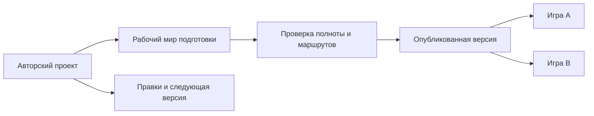

# Пространство автора и независимые игры: архитектура первой версии

Дата: 2026-10-18. Статус: проект архитектуры для реализации; этот документ не означает, что функциональность уже существует.

## 1. Назначение и договорённости

Администратор готовит повторно используемое приключение в отдельном пространстве автора. Он задаёт пожелания, поэтапно получает мир, сюжет и действующих лиц, заранее генерирует все предусмотренные карты и связи, проверяет результат и публикует версию. При создании игры администратор выбирает опубликованную версию из библиотеки. Изменения одной игры не меняют источник и другие игры.

Существующие `/new`, создание `Campaign`, кабинет кампании и запущенные игры сохраняются. Новое пространство добавляется отдельными страницами и API. Пользовательский термин «Кампании» в авторской библиотеке означает подготовленные приключения; «Игры» — их независимые запуски. Backend-модель `Campaign` продолжает обозначать игровое состояние; существующая `GameSession` остаётся записью отдельной встречи внутри игры.

Автор может не раскрывать сюжет: сводка готовности доступна без карт, имён, тайн и содержания проверок со спойлерами. Полный просмотр и редактирование включаются явно.

### Требования

| ID | Требование первой версии |
| --- | --- |
| R01 | Старый путь создания и существующие игры работают без миграции в новый пользовательский процесс. |
| R02 | Отдельная библиотека авторских проектов и отдельный UI подготовки для администраторов. |
| R03 | Пожелания автора/игроков, лор и понятия, сюжет, антагонисты, NPC, ключевые предметы доступны для просмотра и правок. |
| R04 | Поэтапная подготовка с результатами, состояниями, расходами, повтором отдельного этапа и восстановлением после перезапуска. |
| R05 | Все предусмотренные локации и их участки, обязательное наполнение и содержимое авторских контейнеров подготовлены до публикации. |
| R06 | Регионы, подписанные локации и маршруты видны в иерархии и на схеме; подробные карты используют существующий рендерер. |
| R07 | У каждого внешнего маршрута определены участок выхода, участок входа, направление и условия прохождения. |
| R08 | Автоматические проверки ссылок, размещения и достижимости блокируют публикацию при технических ошибках. |
| R09 | Опубликованная версия неизменяема; запуск импортирует отдельное исходное состояние без новой генерации базового мира. |
| R10 | Две игры одной версии имеют независимые NPC, предметы, карты исследования и сюжетный прогресс. |
| R11 | Правки проекта не меняют опубликованные версии и уже созданные игры. |
| R12 | Секретные материалы недоступны через обычные игровые API и режим сводки. |
| R13 | Текущие генераторы, контракты карт, учёт вызовов модели и правила доступа переиспользуются через серверные адаптеры. |
| R14 | Повторы запросов, конфликты ревизий и фоновые задачи не создают дубли и не применяют устаревшие результаты. |
| R15 | Создание игры выбирает опубликованное приключение и его версию; новая игра использует существующие лобби, героев и игровой движок. |
| R16 | NPC имеют постоянную идентичность и исходное размещение либо явное условие появления; описание мастера опирается на сохранённое состояние. |

## 2. Рассмотренные варианты

| Вариант | Последствия |
| --- | --- |
| Новый экран над текущей кампанией | Дёшево для просмотра, но подготовка и игра остаются одним состоянием; повторное использование и защита источника не решаются. |
| Полностью отдельный генератор и формат мира | Чистое разделение, но дублируются генерация, геометрия, наполнение, шаблоны и проверка. Слишком большой первый шаг. |
| Отдельный авторский проект с изолированным рабочим миром и публикацией снимка | Рекомендуется. Домен и API отделены от игры; существующие генераторы работают с привычным контекстом. Снимок становится границей переиспользования. |

Изолированный рабочий мир — технический адаптер, а не игра, доступная из игрового лобби. Он не запускает героев, игровые сессии, угрозы, повествование и звук.

## 3. Домен и хранение



### Новые записи

| Модель | Поля и ответственность |
| --- | --- |
| `AuthorProject` | `id`, `owner_id`, `title`, `workspace_campaign_id` UNIQUE, `draft_revision`, `archived_at`, даты. Владелец процесса подготовки. |
| `AdventureVersion` | `id`, `project_id`, `version`, `schema_version=1`, `source_revision`, `source_digest`, `publish_request_key`, `public_summary`, `bundle`, `validation_report`, `published_at`. UNIQUE `(project_id, version)` и `(project_id, publish_request_key)`. Неизменяемый проверенный источник. |
| `AuthorJob` | `id`, `project_id`, `stage`, `target_ref`, `input_digest`, `status`, `request_key`, `lease_token`, `lease_until`, `attempt_count`, `operation_refs`, `result`, `error_code`, даты. Сохранённая координация этапов. |
| `GeographyNode` | `id`, `campaign_id`, `ref`, `plot_ref`, `entity_id`, `parent_id`, `kind`, `name`. `kind` включает регион и локацию; региону не нужна игровая `Entity`. |
| `GeographyLink` | `id`, `campaign_id`, `ref`, `from_node_id`, `to_node_id`, `from_area_ref`, `to_area_ref`, `bidirectional`, `kind`, `state`, `hidden`, `constraints`. Постоянный маршрут и точки подключения. |

У `Campaign` добавить `purpose: game | author_workspace` с default/server_default `game` и nullable `adventure_version_id`, `launch_request_key`, `launch_input_digest`. Ненулевой ключ запуска уникален в пределах owner: повтор возвращает ту же игру, а повтор ключа с другими параметрами даёт конфликт. Старые записи остаются играми. Обычный API создания не принимает произвольный `purpose`: рабочий мир создаёт только авторский сервис.

У `LlmCall` добавить nullable `author_job_id`, чтобы расходы этапа определялись прямой привязкой, а не временным интервалом. Ручные правки журналируются существующими `Event` рабочего мира с инструментом `author_edit`, request key и обратной дельтой; новая таблица истории не нужна.

Реальные сущности, Blueprint, резервы генерации и зацепки рабочего мира хранятся в существующих таблицах с его `campaign_id`. Нельзя одновременно поддерживать независимые копии черновика в `AuthorProject` и `CampaignSecret`: до публикации содержимое живёт в рабочем мире, проект хранит управление и ревизию.

Существующие `CampaignPlan` — версии сюжетного каркаса, а не опубликованные снимки мира. Их назначение не меняется. `AdventureModule` для импортированных книг не переопределяется: новый источник не должен автоматически включать канонические переходы книжного приключения.

### Ограничения целостности

- У географических узлов UNIQUE `(campaign_id, ref)`, частичная уникальность ненулевых `(campaign_id, plot_ref)` и `(campaign_id, entity_id)`.
- Связанные узлы, родитель и `Entity` принадлежат одному рабочему или игровому миру; проверка на записи и составные FK, где применимо.
- Иерархия регионов не содержит циклов; циклы маршрутов разрешены.
- Один маршрут допускает встречное движение только при `bidirectional=true`.
- Мировые записи участвуют в `Campaign.world_revision`; авторские правки используют `expected_revision`, увеличивают `draft_revision` и сохраняют журнал изменений.
- Фоновые изменения и действия редактора проходят один слой мутаций. Прямой SQL и редактирование произвольного JSON клиентом не являются поддерживаемым API.
- Полезные результаты генерации сохраняются при блокировке этапа. Превышение бюджета останавливает следующий платный вызов, а не удаляет черновик.

## 4. Переиспользование текущих механизмов

| Текущая часть | Изменение |
| --- | --- |
| `NewCampaignPage`, `brief` и параметры генерации | Выделить общие поля анкеты и чистую сборку параметров; создание и навигация старой страницы остаются прежними. |
| `PlotTab`, `app/api/plan.py`, `architect.generate()` | Переиспользовать схемы и генератор через авторский сервис. Вызов генерации для рабочего мира явно отключает вступление и игровые побочные эффекты. |
| `develop`, `create_location`, `layout.plan` | Выделить идемпотентную материализацию без перемещения сцены; новый процесс не симулирует приход героев. |
| `WorldGenerationState`, `Orchestrator` | Сохранить фазы layout, geometry, initial, container_contents, lease, retry и учёт. Авторский job координирует их, не заменяет генератор. |
| `LocationMapSvg`, `SketchSurface` | Переиспользовать чистый рендеринг с отдельной авторской проекцией, не раскрывая туман войны игровым зрителям. |
| `topology.location_exits()` | Добавить географические выходы и использовать один результат для карты, контекста и проверки движения. |
| Панель инструментов мастера | Переиспользовать схемы разрешённых операций и формы, но авторские команды идут через `/author/...` и не вызывают игровой endpoint. |
| `LlmCall` и отчёты расходов | Учитывать реальные генерационные вызовы рабочего мира; запуск игры не копирует историю расходов как новые расходы. |

Проверить все обходы `Campaign` в startup/recovery/фоновых службах: рабочий мир исключается из игровых процессов, но его запрошенные задачи генерации обслуживаются авторским runner и общим preparer.

## 5. Этапы подготовки

```text
Пожелания → Лор и понятия → Сюжет и действующие лица → География
         → Материализация → Все карты и наполнение → Проверка → Публикация
```

На первом этапе сюжет, NPC, антагонисты и улики может по-прежнему создавать один вызов существующего архитектора. UI показывает отдельные группы результатов; отдельный LLM на каждую вкладку не обязателен. Лор хранится в `CampaignSecret.setting`, сюжет — в `plot`. Ключевые предметы получают структурированные определения и размещения: наличие предмета только в тексте не считается подготовкой.

Состояния job: `queued | running | ready | blocked | cancelled`. Состояние отображаемого этапа вычисляется из jobs и актуальности входов: `not_started | running | ready | stale | blocked`. Публикация — отдельная операция над текущей ревизией; наличие старой опубликованной версии не делает изменённый черновик готовым.

Job уникален по `(project_id, stage, target_ref, input_digest)`. Все запросы запуска и правок имеют idempotency/request key. Lease и контроль входного digest препятствуют двойному исполнению и применению устаревшего результата. После падения runner продолжает задачи с сохранённого состояния.

### Полная подготовка в пределах объявленного объёма

- Материализовать каждую сюжетную локацию без смены игровой сцены.
- Подготовить layout каждого комплекса и geometry каждого его участка, включая секретные.
- Подготовить наполнение всех предусмотренных участков и авторских контейнеров с ограничениями числа объектов и глубины вложенности из профилей.
- Материализовать запланированных NPC и противников, распределить их по участкам и предметам-носителям зацепок. Для отложенных появлений сохранить условие активации и исходную скрытую/неактивную сущность; не требовать, чтобы все NPC уже стояли перед героями.
- Привязать ключевые предметы к конкретным местам, контейнерам или NPC.
- Запросить только отсутствующие результаты. Повтор готового этапа не вызывает LLM без изменения входов или явного задания нового варианта.

Никаких проходов по всем вариантам будущего сюжета: публикуются исходные условия и правила, а результаты действий игроков возникают в игре. Новый контент за пределами опубликованного объёма разрешён во время игры по её настройкам.

### Правки и актуальность

Ручная правка текста меняет соответствующий объект. Изменение имени NPC не перестраивает карту. Изменение состава частей помечает зависимые layout, geometry, размещения и проверки устаревшими. Замена маршрута затрагивает его конечные порты и проверку связности, но не все регионы.

Удаление используемой сущности возвращает список зависимостей; применение требует явного исправления этих ссылок. UI показывает, какие результаты станут stale, до запуска повторной генерации. Старый готовый результат можно просмотреть, но публикация со stale-зависимостями запрещена.

`stale` — состояние авторской актуальности, а не новое значение `WorldGenerationState.status`. Повторная генерация авторского результата — явная новая ревизия: прежнее представление сохраняется в журнале, кандидат готовится и проверяется до атомарной замены. Резервы и производные объекты изменяются с проверкой provenance/revision; нельзя просто очистить ready-резерв и добавить второй набор объектов рядом. В обычных играх семантика однократной подготовки WGS сохраняется.

ИИ-редактор в MVP принимает просьбу о конкретном объекте или этапе, выдаёт структурированное предложение правок и список затронутых результатов. Применение идёт тем же API правок с `expected_revision`. Произвольное исполнение игровых инструментов и полноценный чат с неограниченной автономией в MVP не входят.

## 6. География и переходы

Компилятор использует `spatial.links` старого каркаса и новые явные маршруты. В legacy links наличие ссылки с одной стороны означает двустороннее соседство; встречная ссылка не создаёт второй маршрут. Для нового проекта точки подключения маршрута указываются явно: например, `loc_cave/part_crawl → loc_tunnels/part_junction`. Несколько параллельных маршрутов имеют разные ref.

Внутренние проходы остаются в Blueprint. Внешний маршрут принадлежит географическому реестру. Его порт — сохранённая привязка к конкретной части и клеткам выхода, проецируемая в sketch/карту. Допускается начальная схема без точных глобальных координат: подписанные узлы регионов и локаций и линии маршрутов.

Не подставлять географический ID в `End.place_id`, ожидающий `Entity`. Расширить DTO выхода необязательным `route_id`; отдельный resolver разрешает маршрут в реальный участок назначения. Рендеринг и gateway получают типизированный вариант географического выхода. Внутренние Blueprint-проходы сохраняют существующую семантику.

На публикации все исходные маршруты имеют реальные участки и допустимые клетки входа/выхода. В новой игре `travel_route` проверяет текущий участок, доступность маршрута, героев и точку входа, затем атомарно перемещает их. Генерация назначения для исходного опубликованного мира не требуется. Ошибка означает отсутствие перемещения; запасной маршрут автоматически не выбирается.

Явный выбор route_id связывается с заявкой игрока. Для текста «дальше» контекст передаёт возможные направления; при неоднозначности возвращаются варианты уточнения. Сама доступность обратного прохода не является основанием считать его продолжением пути.

`_connect()` не создаёт дорогу в результате обычного движения по географическому маршруту или телепортации. Старый режим свободных кампаний сохраняет прежнюю совместимость. Авторские маршруты и обычные state.links не выступают конкурирующими источниками одной связи.

## 7. Проверка готовности

`validate_project` возвращает `ValidationReport(source_revision, source_digest, errors, warnings, coverage)`. Ошибки имеют стабильные code, object_ref и связанные refs; для режима без спойлеров существует отдельная проекция.

Обязательные детерминированные проверки:

1. Все ссылки разрешаются, типы и принадлежность миру корректны.
2. Каждый предусмотренный комплекс и участок имеет актуальную готовую карту; готовность одного plot не считается готовностью приключения.
3. Назначения маршрутов существуют; клеточные порты находятся на проходимой геометрии. Внутри участков проверяется путь от входов к необходимым выходам и целям.
4. Обязательные сюжетные места потенциально достижимы из старта. Закрытые двери и тайные маршруты учитываются как условия; отсутствие пути отличается от намеренно заблокированного пути. Для ключей проверяется существование и размещение, а полное решение всех головоломок не обещается.
5. NPC, противники, предметы и улики имеют корректные размещения/условия появления; отсутствуют случайные дубли сюжетных привязок.
6. Нет активных, blocked или stale задач, относящихся к обязательному объёму публикации.
7. Пакеты контента, шаблоны и версии источников доступны и зафиксированы.

Опциональная проверка смысла моделью имеет отдельный бюджет и статус. Она ищет противоречия истории, но не заменяет проверки ссылок и геометрии. Симуляция переходов выполняется на тестовом/временном состоянии, не посещает карты от имени автора и не изменяет базовый мир.

## 8. Публикация и запуск игры

`publish(project_id, expected_revision)` проверяет актуальный отчёт и отсутствие работ, получает согласованный снимок и сохраняет новую `AdventureVersion`. Контроль ревизии исключает публикацию результата, проверенного до последних правок. Повтор запроса публикации возвращает ту же версию по request key.

Bundle версии — типизированный формат, а не дамп всех таблиц:

- Анкета и ограничения приключения, лор, сюжет, публичная завязка, версии контентных пакетов.
- Определения сущностей с логическими refs вместо ссылок на строки рабочего мира.
- География, Blueprint, геометрия, порты маршрутов и исходные размещения.
- Подготовленное наполнение, предметы в контейнерах, привязки зацепок и исходные условия активации NPC.
- Данные, достаточные для восстановления готовых резервов генерации и их manifest без повторной оплаты LLM.
- Проверка готовности и версия формата.

Не входят: пользователи и агенты с настройками доступа, API-ключи, герои игроков, приглашения, сообщения, игровые сессии, события подготовки, player/map knowledge, посещённость, очередь переходов, боевое состояние, lease и история LLM-вызовов.

Экспорт/импорт реализует явные адаптеры известных схем. Перечень обязательных ссылочных полей включает `Entity.location_id`, `state.links`, complex/root/area maps, Blueprint external ends, sketch exits и происхождение объектов, plot entity bindings, anchor bindings, manifests генерации и содержимое контейнеров. Разметка ссылок `[[id|название]]` в авторском тексте обрабатывается отдельным адаптером; ссылки на шаблоны/пакеты остаются внешними фиксированными refs. Неизвестная ссылочная структура блокирует публикацию с конкретным кодом. Нельзя заменять все строки по regex или слепо копировать Entity.state.

`instantiate(version_id, options, request_key)` создаёт обычный `Campaign(purpose=game, adventure_version_id=...)`, новые ID всех изменяемых строк и remap логических refs. В одной транзакции создаются исходный мир и свежие runtime-метаданные; неполная игра не видна в списке. Если объём требует фонового импорта, запись остаётся initializing до полного атомарного переключения в lobby.

Источник задаёт состав приключения и фиксированные версии пакетов. Настройки запуска задают игроков, мастера, озвучку и допустимые параметры сложности. Несовместимая смена правил/пакетов не выполняется незаметно при запуске.

Начальная сцена определяется опубликованным start_ref. Герои размещаются существующим процессом лобби при старте, без повторного develop первой локации. Вступление создаётся для конкретной группы. Обзор автором не означает исследование карт игроками. Контейнеры и условия NPC начинают каждую игру с опубликованного исходного состояния; случайные броски и сюжетные последствия независимы.

Готовые WGS восстанавливаются с локальными IDs, очищенными lease и актуальными manifests. Импорт не помечается «legacy_preserved» для обхода проверок. `NarrativeState` и индекс фактов строятся заново из исходного сюжета, не копируются из технической активности подготовки.

## 9. API и UI

### Маршруты интерфейса

- `/author` — проекты, готовность, версии, создание из общей анкеты.
- `/author/:projectId` — `AuthorWorkspace`, этапы и сводка.
- `/author/:projectId?view=full` — полный просмотр после явного раскрытия, списки объектов и карты.
- `/games/new` — библиотека доступных опубликованных приключений, выбор версии и параметры игры.
- Старые `/new`, `/c/:id`, `/c/:id/manage` остаются.

Компоненты: `AuthorWorkspace`, `StagePanel`, `ContentEditor`, `GeographyView`, `MapPreview`, `ValidationPanel`. Общими с legacy становятся поля анкеты и чистые компоненты отображения, а не состояние навигации или игровые stores. `MapPreview` получает данные и callbacks через props; не отправляет map.step, map.traverse, запросы исследования и изменения героя.

### Контракты API

Все новые endpoints имеют типизированные Pydantic DTO и включаются в генерацию клиентских типов.

| Метод и путь | Назначение |
| --- | --- |
| `GET/POST /api/author/projects` | Свои проекты, создание проекта и рабочего мира. |
| `GET /api/author/projects/{id}?view=summary|full` | Раздельные проекции без спойлеров/для редактора. |
| `POST /api/author/projects/{id}/prepare` | Stage, optional target_ref, expected_revision, request_key; очередь подготовки. |
| `GET /api/author/projects/{id}/jobs` | Результаты, прогресс, расходы и ошибки. |
| `POST /api/author/projects/{id}/edits/preview` | Предложение ограниченных правок от ИИ, не применяет их. |
| `POST /api/author/projects/{id}/edits` | Типизированные ручные/подтверждённые правки, контроль ревизии. |
| `GET /api/author/projects/{id}/maps/{location_ref}` | Полная авторская карта для явно открытого режима. |
| `POST /api/author/projects/{id}/validate` | Детерминированная проверка текущей ревизии. |
| `POST /api/author/projects/{id}/publish` | Неизменяемая версия после успешной проверки. |
| `GET /api/adventures` | Разрешённая библиотека опубликованных версий со сводкой. |
| `POST /api/adventures/{version_id}/games` | Создание независимой игры, без запуска платной генерации мира. |

Доступ к редактированию: admin/super_admin и владение проектом; совместное редактирование не входит в MVP. Библиотека первой версии — свои опубликованные проекты; публичный маркетплейс не требуется. Обычный игрок получает доступ к конкретной игре по прежним правилам. Права администратора сами по себе не отдают полный bundle через игровые API.

## 10. Минимальный выпуск и последующие расширения

В MVP входят R01–R16, ручные формы и ограниченные AI-предложения правок, схемы регионов, готовые подробные карты, проверка, публикация и два независимых запуска. Старый интерфейс не удаляется и не становится обязательным путём в пространство автора.

Позже: свободный чат редактора, визуальное рисование регионов, точная глобальная геометрия, совместное авторство, публичный обмен, импорт legacy-игры в авторский проект, обновление уже начатой игры на новую версию. Эти расширения не нужны для проверки основного сценария.

### Сценарий приёмки

Создать проект из анкеты: три региона, пещера с Обвалом и Узким лазом, Гладкие туннели, Зал Ничто, NPC, ключевой предмет и улика. Заранее подготовить все карты, увидеть связи конкретных участков, исправить одно размещение и опубликовать v1. Создать игры A и B, пройти Узкий лаз → Туннели → обратно. В A забрать предмет и изменить судьбу NPC; в B исходное состояние сохраняется. Опубликовать v2 с другой картой: A и B остаются на v1. Перезапуск на этапе подготовки и повтор запуска не создают дублей. Legacy `/new` продолжает работать.

План работ: `docs/superpowers/plans/2026-10-18-author-workspace.md`.
